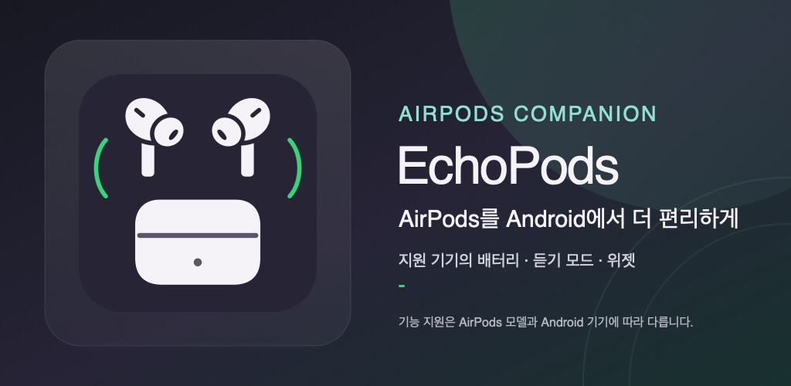

# EchoPods



EchoPods brings AirPods battery status and supported device controls to Android. It is an independent companion app with its own name, artwork, widgets, update channel, and Android-focused compatibility behavior.

**Android 12 or newer · GPL-3.0-or-later · No Apple or LibrePods affiliation**

## Features

- Separate left, right, and case battery status when the connected Bluetooth stack reports it.
- Connection and case popups, low-battery alerts, and home-screen widgets.
- Listening-mode controls, press-and-hold actions, and Quick Settings controls on supported combinations.
- Optional wear detection and media pause/resume, with support varying by AirPods firmware and Android media-session behavior.
- Model-aware settings and product artwork where the model can be identified.

Not every Android phone exposes the same AirPods data or controls. Installation requires Android 12 or newer; the features that work depend on the AirPods model and firmware, phone Bluetooth chipset, Android build, and manufacturer software. Some combinations provide only ordinary Bluetooth audio. EchoPods does not claim universal support for Find My, heart-rate sensing, head-tracked spatial audio, or two-way audio features.

## Get EchoPods

- **GitHub/FOSS build:** APKs and version notes are published on the [Releases page](https://github.com/blossom0948/EchoPods/releases). Android requires the user to confirm sideloaded app installation. The app's GitHub updater is available only in this build.
- **Google Play build:** the `play` flavor is prepared separately and omits the GitHub APK updater; Play updates are managed by Google Play. It is not represented as published until a Play Console release is actually made.

Android checks the signing certificate when updating an installed app. The existing GitHub install channel must keep its current signing identity unless a planned migration tells users how to move to a different one. See [Play readiness notes](docs/PLAY_STORE_READINESS.md) for the verified certificate and store-transition constraints.

## Build from source

Use Android Studio's JDK 21+ runtime and install Android SDK Platform 37, NDK `30.0.14904198`, and CMake `3.22.1`.

```sh
./gradlew :app:assembleFossDebug
./gradlew :app:assemblePlayDebug
```

Public release artifacts require a stable signing configuration in the untracked local `local.properties` file:

```properties
RELEASE_STORE_FILE=/absolute/path/to/upload-key.jks
RELEASE_STORE_PASSWORD=...
RELEASE_KEY_ALIAS=...
RELEASE_KEY_PASSWORD=...
```

Then build `:app:assembleFossRelease` for a GitHub APK or `:app:bundlePlayRelease` for a Play App Bundle. Release builds intentionally fail when signing information is absent. Never commit a keystore or its passwords. The Play App Bundle signing key is an **upload key**; Google Play signs delivered APKs with the separately configured app-signing key.

## Open source and acknowledgements

The active Android client contains code adapted from the GPL-3.0-or-later [LibrePods Android project](https://github.com/librepods-org/librepods). EchoPods has developed its own product identity and Android-specific behavior on top of that licensed source. Upstream copyright and license notices remain in imported files; the source revision and changes are recorded in [UPSTREAM.md](UPSTREAM.md), [NOTICE](NOTICE), and [LICENSE](LICENSE). GPL licensing covers the applicable source code, not separately licensed third-party names, logos, or artwork.

EchoPods is not affiliated with or endorsed by Apple or LibrePods. AirPods is a trademark of Apple Inc. Product names are used only to identify compatibility.

The earlier EchoPods implementation and its tests remain under [`legacy-app/`](legacy-app/) for development history; they are not part of the active Android build.
